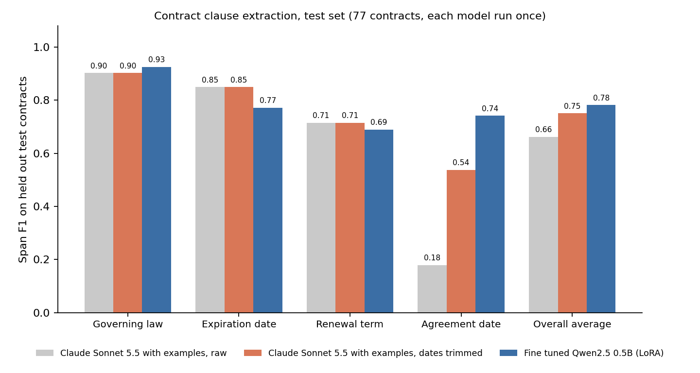

# Fine tuning a small model versus prompting Claude for contract clause extraction

A 0.5 billion parameter open model, fine tuned with LoRA on 357 contracts, is statistically indistinguishable from Claude Sonnet 5.5 on overall extraction quality on held out contracts (0.782 against 0.751 span F1 once Claude's date quotes are normalized, 0.662 raw), while costing roughly 30 to 90 times less per chunk to run at assumed GPU rates. Claude is clearly better at one field, the small model is clearly better at another, and the rest are ties.



## The task

Given an excerpt of a commercial contract, return exact quotes for four things. These are the governing law, the expiration date or term, the renewal terms, and the date the agreement was made. Data comes from CUAD, the Contract Understanding Atticus Dataset, which has 510 real contracts with lawyer labeled clause highlights (https://github.com/TheAtticusProject/cuad). See that repository for license terms.

The labels are highlighted spans of contract text and not clean values, so quality is scored with token overlap F1 against the highlighted text. Governing law and renewal term labels are full sentences. Agreement date labels are usually just the date, with a median of 3 words.

## Method

**Split.** 510 contracts split by contract into 357 train, 76 validation, and 77 test, with a fixed seed, so no contract appears in two splits. The test set was run exactly once per model and nothing was tuned afterward.

**Chunks.** Contracts are long, with a median near 8,000 tokens and a long tail far beyond that. Each is cut on whitespace into chunks of about 2,500 characters with 500 characters of overlap. Both models read one chunk at a time and return a JSON object with four lists of exact quotes. Chunk predictions are merged per contract and deduplicated. About 0.5 percent of gold spans (8 of 1,617) straddle every chunk boundary, so a perfect oracle scores 0.996 and not 1.0.

**Training data.** Only about a tenth of chunks contain any answer, so for training I kept every positive chunk plus two random negatives per positive, which gives 3,099 examples, of which 4 were dropped for length. Validation and test keep every chunk at its natural rate.

**Small model.** Qwen2.5 0.5B Instruct with LoRA (rank 16, all attention and MLP projections), 1 epoch, learning rate 2e-4, effective batch size 16, loss on completion tokens only. Training took about 77 minutes on a free Colab T4 GPU. A 1.5B model was started first and abandoned because it ran at about 66 seconds per step on the same GPU.

**Frontier baseline.** Claude Sonnet 5.5 with the identical prompt plus four worked examples, one per field, each the shortest matching training example. A zero example run on validation scored 0.657 raw and 0.715 trimmed against 0.690 and 0.798 with examples, so the examples helped.

**Evaluation.** For each contract and field, token F1 between merged predicted quotes and gold quotes, averaged over contracts that have that field. Presence precision and recall measure whether a model correctly says a clause exists. Differences between models use a paired bootstrap over contracts, with 95 percent intervals.

## Results on the test set

Span F1, 77 test contracts. Contracts with each field are 64 for governing law, 63 for expiration date, 32 for renewal term, and 70 for agreement date.

| Field | Claude raw | Claude dates trimmed | Small model | Small minus Claude (trimmed), 95% interval |
|---|---|---|---|---|
| Governing law | 0.903 | 0.903 | 0.926 | -0.025 to +0.066 |
| Expiration date | 0.850 | 0.850 | 0.772 | -0.136 to -0.023 |
| Renewal term | 0.715 | 0.715 | 0.690 | -0.172 to +0.106 |
| Agreement date | 0.179 | 0.538 | 0.742 | +0.088 to +0.314 |
| Overall average | 0.662 | 0.751 | 0.782 | -0.016 to +0.077 |

Against raw Claude output the overall interval is +0.074 to +0.164 in the small model's favor, but that gap comes almost entirely from agreement date.

### Cost and speed

| | Claude Sonnet 5.5 | Small model |
|---|---|---|
| Test run, 1,772 chunks | $13.23 | about 25 GPU minutes |
| Per 1,000 chunks | $7.47 | about $0.08 to $0.24 |
| Latency | median 1.4 s per call | median 5.7 s per batch of 8, about 0.9 s per chunk |

Claude cost uses $2 per million input tokens and $10 per million output tokens at the time of the run. The small model cost assumes a rented T4 at $0.35 to $1.00 per hour, which is an assumption and not a measurement, so check real prices. Training itself was free on Colab and took about 77 minutes. The two latency figures are not directly comparable because the models were run differently.

## What I learned

**A scoring trap was hiding most of the headline gap.** Claude found the agreement date in essentially every contract, with token recall of 1.0, but it quoted the surrounding sentence (a median of 52 words with no examples) where the labels expect the bare date (a median of 3 words). The fine tuned model learned the labeling convention from examples. Showing Claude four worked examples cut its quote length to a median of 13 words but did not close the gap. A simple rule that trims quotes down to the date text, written using validation data only, recovers much of it, so I report raw and trimmed scores side by side and not just the flattering one.

**Claude reads the harder clauses better.** The one field where Claude is clearly ahead is expiration date, where term language is often indirect. The small model's mistakes there are mostly extra sentences it pulls from elsewhere in the contract, such as a definition of a calendar year.

**The small model is cautious on renewal terms.** It rarely claims a renewal clause that is not there (presence precision 1.0) but misses about a fifth of real ones (recall 0.81), while Claude catches nearly all of them and is wrong more often.

**Some errors are label noise.** In one validation example the gold renewal term was a data protection clause, so some apparent model errors are labeling errors.

## Limitations

One training run with one random seed and one pass over the data, so I do not know how much the small model's result varies. The test set has 77 contracts and only 32 with a renewal term, so field level conclusions are loose, and only the expiration date and agreement date differences are statistically clear. Claude's four examples were chosen mechanically as the shortest matching training examples and the prompt was not otherwise tuned, and only one frontier model was tested. The date trimming rule is a heuristic regular expression. Chunk predictions are merged without confidence scores, so extra quotes hurt precision for both models. The GPU cost figures rest on assumed hourly prices.

## Reproduce

```
# data
curl -L -o data.zip https://github.com/TheAtticusProject/cuad/raw/main/data.zip
unzip data.zip
python build_dataset.py        # split by contract and chunk
python make_prompts.py         # prompt and completion files in out/

# frontier baseline, needs ANTHROPIC_API_KEY set in your environment
python baseline_claude.py --split val --cover_fields
python score_preds.py out/preds_claude-sonnet-5-5_cover_val.jsonl --split val --price_in 2 --price_out 10 --trim_dates

# small model, on a GPU (the free Colab T4 works)
pip install transformers peft accelerate
python train_lora.py --epochs 1 --model Qwen/Qwen2.5-0.5B-Instruct --out lora_out_0p5b
python infer_lora.py --split val --adapter lora_out_0p5b/adapter
python score_preds.py out/preds_lora_val.jsonl --split val --trim_dates
```

The test split is run once at the very end by passing `--split test`. Never put an API key in the repository.

## Files

```
build_dataset.py     split by contract, chunk, gold spans
make_prompts.py      prompt and completion pairs shared by both models
baseline_claude.py   prompted frontier model baseline with token and latency logging
train_lora.py        LoRA fine tune
infer_lora.py        batched inference with the adapter
evaluate.py          contract level scoring and date trimming
score_preds.py       quality, cost, and speed report for any predictions file
out/                 prompt files, gold answers, and all model predictions
```
